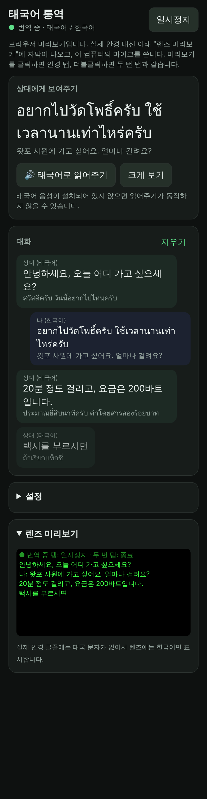

# Thai Translator for Even G2

Even Realities G2 안경용 **태국어 ⇄ 한국어 실시간 통역** 앱(Even Hub 플러그인)입니다.

- **상대가 태국어로 말하면** 안경 렌즈에 한국어 자막이 나옵니다.
- **내가 한국어로 말하면** 휴대폰 화면에 태국어 번역이 크게 나옵니다. 상대에게 보여주거나 소리로 읽어줄 수 있습니다.
- 말하는 언어는 자동으로 구분되므로 버튼을 누를 필요가 없습니다.



## 가장 쉬운 설치(컴퓨터 필요 없음)

1. 구글 계정으로 [aistudio.google.com/apikey](https://aistudio.google.com/apikey)에 들어가 **API 키 만들기(Create API key)**를 누르고 키를 복사합니다(무료).
2. 휴대폰 Even 앱에서 **개발자 모드(Developer Mode) → Scan**을 엽니다.
3. 아래 QR을 스캔합니다.
4. 앱이 열리면 **설정 → Gemini API 키**에 붙여넣고 **저장하고 다시 연결**을 누릅니다.


QR 주소: `https://gyflea-web.github.io/even-g2-thai-translator/`

## 왜 렌즈에 태국 문자는 안 나오나요?

G2 기본 펌웨어 글꼴에는 태국 문자가 없습니다. 태국 문자를 보내도 렌즈에 아무것도 표시되지 않습니다(`@evenrealities/pretext` 글꼴 표에서 태국 문자 폭이 0으로 확인됨).
그래서 렌즈에는 한국어만 띄우고, 태국어는 휴대폰 화면과 음성으로 보여줍니다.

## 번역 서비스 고르기

| | Google Gemini (기본) | Soniox |
|---|---|---|
| 키 받는 곳 | [aistudio.google.com/apikey](https://aistudio.google.com/apikey) (구글 계정) | [console.soniox.com](https://console.soniox.com) |
| 요금 | 무료 사용량 있음(분당 요청 수 제한) | 유료(사용 시간만큼) |
| 속도 | 말이 끝나고 1~3초 뒤 문장 단위로 표시 | 말하는 도중에 바로 표시 |

> Gemini 무료 사용량으로 보낸 내용은 구글이 서비스 개선에 쓸 수 있습니다. 민감한 대화라면 유료 요금제나 Soniox를 쓰세요.

## 준비물

1. 위 표의 API 키 중 하나
2. Even 앱 **2.2.10 이상**
3. Node.js 20 이상이 설치된 컴퓨터(설치용)

## 개발자용: 컴퓨터에서 띄워 설치하기

컴퓨터와 휴대폰을 **같은 Wi-Fi**에 연결합니다.

```bash
npm install
```

```bash
npm run dev
```

다른 터미널에서 QR 코드를 띄웁니다. IP 자리에는 컴퓨터의 내부 IP를 넣습니다.

```bash
npx evenhub qr --url http://192.168.0.10:5173
```

Even 앱으로 QR을 스캔하면 앱이 열립니다. 휴대폰 화면의 **설정**에 Soniox API 키를 넣고 **저장하고 다시 연결**을 누르면 바로 번역이 시작됩니다.

패키지 파일(`.ehpk`)을 만들 때는 아래 명령을 씁니다.

```bash
npm run pack
```

## 사용법

| 조작 | 동작 |
|---|---|
| 안경(템플/링) 탭 | 일시정지 / 다시 시작(일시정지하면 마이크도 꺼짐) |
| 안경 두 번 탭 | 앱 종료 |
| 휴대폰 "태국어로 읽어주기" | 내 마지막 말의 태국어 번역을 소리로 읽음 |
| 휴대폰 "크게 보기" | 태국어 번역을 화면 가득 크게 표시(상대에게 보여주기) |

설정 항목은 다음과 같습니다.

- 마이크: 안경 마이크(기본) 또는 휴대폰 마이크
- 내가 한 말도 렌즈에 표시: 켜면 `나: …` 형식으로 표시
- 자동으로 읽어주기: 내 말이 끝나면 태국어 번역을 자동으로 읽음
- 음성 인식 모델: 기본값은 `stt-rt-v6`

> 읽어주기 기능은 휴대폰에 설치된 태국어 음성을 씁니다. 소리가 안 나면 Android는 Google 음성 엔진의 태국어 데이터를, iOS는 설정 → 손쉬운 사용 → 말하기 콘텐츠에서 태국어 음성을 설치하세요.

## 브라우저 미리보기(안경 없이 테스트)

`npm run dev`로 띄운 뒤 컴퓨터 브라우저에서 `http://localhost:5173`을 엽니다. 컴퓨터 마이크로 들은 소리가 "렌즈 미리보기" 칸에 자막으로 나옵니다.
개발할 때 키를 매번 입력하기 싫다면 `.env.example`을 `.env.local`로 복사해 키를 넣으세요. 이 키는 개발 모드에서만 쓰입니다.

## 구조

```
안경 마이크 (PCM 16kHz) ─▶ Even 앱 WebView (이 앱) ─▶ Soniox 실시간 WebSocket
                                   ▲                   (음성 인식 + 태국어⇄한국어 양방향 번역)
                                   └──────── 토큰 ◀────┘
렌즈: 한국어 자막(textContainerUpgrade)   휴대폰: 대화 기록, 태국어 크게 보기, 음성 읽기
```

| 파일 | 역할 |
|---|---|
| `src/gemini.ts`, `src/gemini-stream.ts` | Gemini 호출(문장 단위 음성 → 원문과 번역) |
| `src/vad.ts` | 소리 크기로 말의 시작과 끝을 찾아 문장 단위로 자르기 |
| `src/soniox.ts` | Soniox WebSocket 연결, 자동 재연결, 일시정지 중 keepalive |
| `src/transcript.ts` | 토큰을 발화(상대/나) 단위로 정리 |
| `src/lens.ts` | 렌즈 글자 폭에 맞춘 줄바꿈, 태국 문자 제거, 최근 줄만 표시 |
| `src/glasses.ts` | Even Hub SDK 연결(실제 안경), 브라우저 미리보기 대체 구현 |
| `src/ui.ts`, `index.html` | 휴대폰 화면 |

```bash
npm test
```

## 알려진 한계

- Gemini는 실제 서버에 요청 형식과 오류 처리까지 확인했지만, 진짜 키로 음성을 번역해 보지는 못했습니다. 기본 모델 이름(`gemini-flash-lite-latest`)이 안 맞으면 설정에서 바꿀 수 있습니다.
- 이 개발 환경에서는 Soniox 서버에 접속할 수 없어서 실제 음성 연결은 시험하지 못했습니다. 프로토콜은 Soniox 공식 SDK(`@soniox/client`)의 타입 정의를 기준으로 맞췄고, 화면 동작은 가짜 응답으로 확인했습니다. 실제 안경에서 처음 실행할 때 연결 오류가 나면 휴대폰 화면 상단에 원인이 표시됩니다.
- 렌즈에 태국 문자를 직접 띄우려면 펌웨어 글꼴을 바꿔야 합니다. 커뮤니티 프로젝트 [rayriffy/even-g2-thai](https://github.com/rayriffy/even-g2-thai)가 있지만, 비공식 펌웨어 패치라 보증과 안정성 위험이 있습니다.
